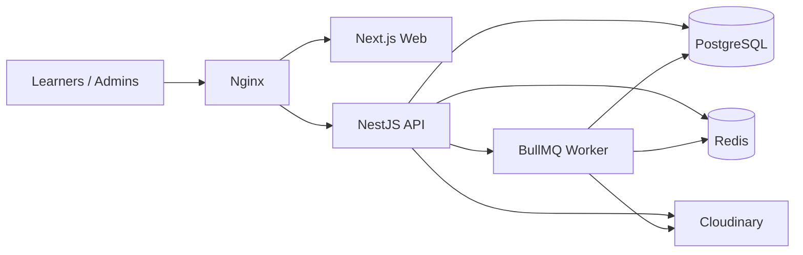

# 00 — Project Overview

## Purpose

Your Academy is a production-oriented, subscription-ready **MCQ EdTech platform**. Learners browse categorized multiple-choice questions, study with explanations during a free trial, save learning resources, follow educational news, and track browsing activity. Administrators operate content, users, and platform analytics.

## Goals

| Goal | Description |
|------|-------------|
| Learning access | Fast discovery of published MCQs by category, difficulty, and search |
| Fair trial | Seven-day full access including answers and explanations |
| Sustainable free tier | Post-trial users keep browsing content without premium answer fields |
| Admin operations | Reliable publishing and moderation workflows |
| Future monetization | Modular subscription model without shipping payments in v1 |
| Operability | Dockerized modular monolith suitable for Ubuntu VPS deployment |

## Non-goals (Initial Release)

- Payment gateway / invoicing
- Mobile native apps
- Microservices / event-sourced architecture
- Real-time collaborative editing
- LMS features (assignments, grading cohorts, live classes)
- Mandatory email verification (email is optional/future-compatible)

## Primary Actors

| Actor | Capabilities |
|-------|--------------|
| Guest | Marketing/public pages; published news; register; log in (no question bank — DEC-003) |
| User (trial-active) | Full MCQ access including answers/explanations; bookmarks; news; PDFs; profile; browsing analytics |
| User (trial-expired / free) | Same browsing as trial including published PDFs (DEC-001); answers, indicators, explanations omitted by API |
| Admin | All user capabilities plus content/user/platform management |

## High-Level System Context

## Documentation Authority

| Concern | Document |
|---------|----------|
| Business rules | `01-business-requirements.md` |
| Features | `02-functional-requirements.md` |
| Architecture | `04-system-architecture.md` |
| Schema | `05-database-design.md` |
| API | `06-api-specification.md` |
| Entitlements | `08-subscription-and-access-control.md` |
| Open questions | `19-decisions-and-assumptions.md` |

Agent instructions: root [`AGENTS.md`](../AGENTS.md).

## Success Criteria for This Phase

- Complete, consistent documentation set
- Confirmed vs proposed decisions clearly separated
- Implementation roadmap with dependencies
- No application feature code yet
