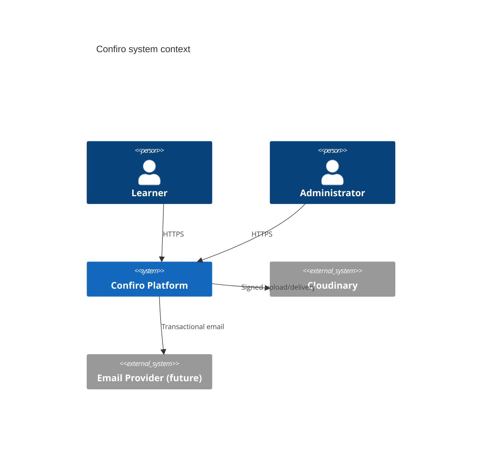
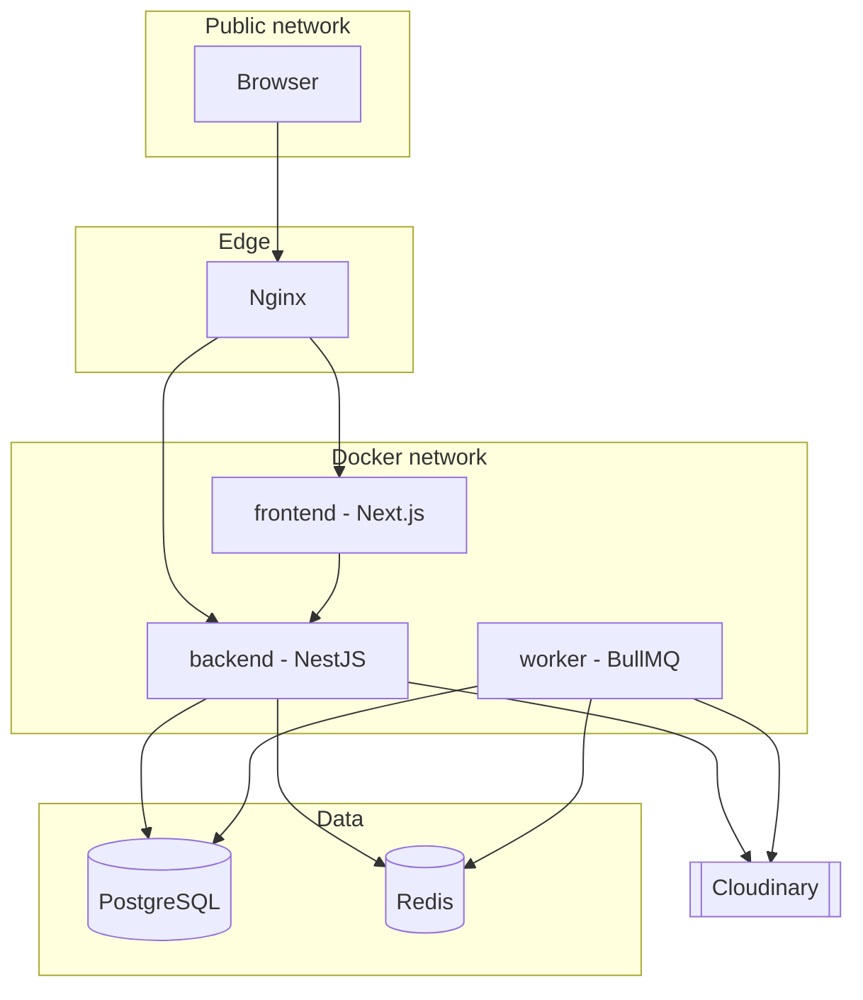
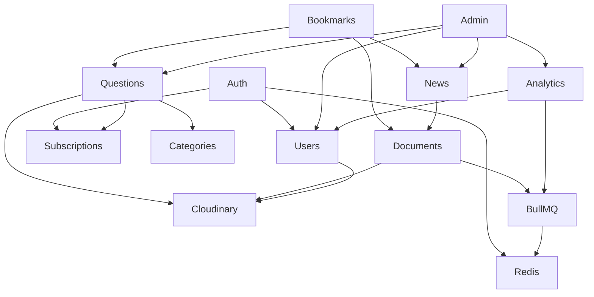

# 04 — System Architecture

## 1. Style

**Modular monolith** deployed as multiple processes/containers from one codebase:

| Process / folder | Responsibility |
|------------------|----------------|
| `frontend/` (`web`) | Next.js UI (SSR/RSC + client islands) |
| `backend/` (`api`) | NestJS REST API, auth, sync business logic, enqueue jobs |
| `worker/` | BullMQ processors |
| `shared/` | Browser-safe types, enums, contracts |
| `postgres` | System of record |
| `redis` | BullMQ broker (+ optional cache) |
| `nginx` | TLS termination, reverse proxy |

Cloudinary is an **external** managed service.

## 2. Context Diagram

## 3. Container Diagram

## 4. Backend Module Map

Logical NestJS modules: Auth, Users, Categories, Questions, Bookmarks, News, Documents, Subscriptions, Analytics, Admin, Cloudinary (Storage), BullMQ, Redis, Database, Health.

## 5. Request Path (Typical Authenticated Read)

1. Browser → Nginx → `api`
2. Helmet/CORS/rate-limit middleware
3. JWT guard → RBAC guard
4. Controller validates DTO
5. Service applies business rules + `AccessControlService`
6. Repository/Prisma query with selective fields
7. Response envelope; restricted fields already omitted

## 6. Write Path with File Upload

1. Client requests signed upload params **or** uploads multipart to API
2. API validates auth, MIME, size
3. StorageService uploads to Cloudinary
4. DB transaction stores metadata + domain row
5. On DB failure after upload: enqueue compensating delete job

## 7. Frontend Architecture Snapshot

Route groups:

- `(public)` — marketing, news listing
- `(auth)` — login/register
- `(app)` — user dashboard, questions, bookmarks, profile
- `(admin)` — admin console

Server Components fetch where cookie/session allows; mutations and heartbeats via Client Components + TanStack Query.

## 8. Shared Package

`shared/` exports:

- Enums (`UserRole`, `QuestionStatus`, `Difficulty`, …)
- Zod schemas for shared validation
- API DTO types / response envelopes
- Entitlement constants

Must remain browser-safe (no Prisma, no Node fs, no secrets).

## 9. Why Not Microservices

Single product, shared data model, small team/AI-assisted delivery, VPS deployment. Module boundaries + separate worker process provide isolation where needed without distributed transaction complexity.

## 10. Evolution

When justified later: extract worker-heavy document processing, add read replicas, introduce payment provider adapter behind `SubscriptionsModule`. Payment webhooks would land in API and update `UserSubscription` without rewriting access checks.
