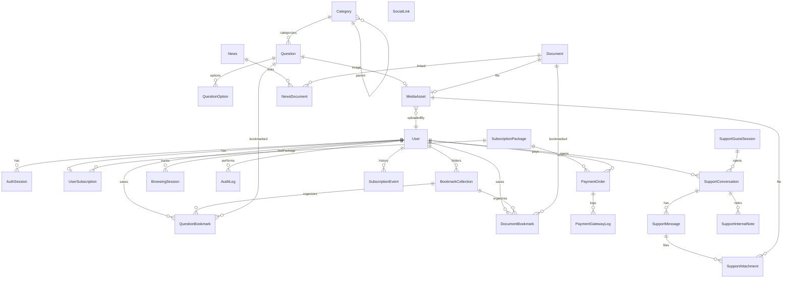

# 05 — Database Design

PostgreSQL via Prisma. Migrations are the source of truth. **Never** use `prisma db push` as the production migration strategy.

**Location:** `backend/prisma/schema.prisma` and `backend/prisma/migrations/`.  
**Commands (repo root):** `pnpm db:deploy`, `pnpm db:seed`, `pnpm db:generate`.

## 1. ER Overview

`SocialLink` (DEC-046) stores admin-managed footer social profiles (`platform` unique, `url`, `enabled`, `sortOrder`). No FK relations — standalone CMS table.

## 2. Soft-Delete Strategy

| Entity | Strategy |
|--------|----------|
| User | Soft: `deletedAt`; unique WhatsApp released or rewritten on delete per DEC-005 |
| Category | Soft prefer: `isActive=false`; hard delete only if no questions |
| Question | Status `ARCHIVED` + optional `deletedAt` |
| News | `isPublished` + optional `deletedAt` |
| Document | `deletedAt`; enqueue Cloudinary cleanup |
| Bookmarks | Hard delete |
| AuthSession | Hard delete / expire |
| AuditLog | Append-only; no delete |

## 3. Entities

### 3.1 User

**Purpose:** Account identity, role, profile, trial window.

`trial_ends_at` TIMESTAMPTZ NOT NULL — DB default `now() + 7 days` (DEC-061); existing rows backfilled from `created_at`. Unlocks Topic Base questions only (DEC-063).

| Field | Type | Notes |
|-------|------|-------|
| id | UUID PK | |
| name | VARCHAR(120) | |
| whatsappNumber | VARCHAR(32) UNIQUE | E.164 normalized |
| email | VARCHAR(255) NULL UNIQUE | Optional |
| passwordHash | TEXT | Argon2id |
| role | ENUM(`USER`,`ADMIN`) | Default `USER` |
| status | ENUM(`ACTIVE`,`SUSPENDED`,`DELETED`) | |
| avatarAssetId | UUID NULL FK → MediaAsset | |
| preferredCategoryIds | UUID[] | Root category interests from onboarding (max 3 in service) |
| lastQuestionId | UUID NULL FK → Question | Continue-learning pointer (`ON DELETE SET NULL`) |
| lastQuestionFilterQs | VARCHAR(512) NULL | Optional filter query string for resume |
| onboardingCompletedAt | TIMESTAMPTZ NULL | Set when onboarding finishes |
| createdAt / updatedAt | TIMESTAMPTZ | |
| deletedAt | TIMESTAMPTZ NULL | Soft delete |

**Indexes:** unique(whatsappNumber); unique(email) where not null; (status); (createdAt).

**Cascade:** Deleting user (hard) cascades sessions, bookmarks, browsing sessions; questions createdBy set null or restrict for admins — prefer `createdById` SET NULL on content.

### 3.2 AuthSession

**Purpose:** Refresh token sessions / rotation.

| Field | Type | Notes |
|-------|------|-------|
| id | UUID PK | |
| userId | UUID FK → User | ON DELETE CASCADE |
| refreshTokenHash | TEXT | |
| familyId | UUID | Rotation family |
| userAgent | TEXT NULL | |
| ipAddress | VARCHAR(64) NULL | |
| expiresAt | TIMESTAMPTZ | |
| revokedAt | TIMESTAMPTZ NULL | |
| replacedBySessionId | UUID NULL | |
| createdAt | TIMESTAMPTZ | |

**Indexes:** (userId); (expiresAt); unique(refreshTokenHash).

### 3.3 Category

**Purpose:** Two-level hierarchy.

| Field | Type | Notes |
|-------|------|-------|
| id | UUID PK | |
| name | VARCHAR(120) | |
| slug | VARCHAR(140) UNIQUE | |
| description | TEXT NULL | |
| parentId | UUID NULL FK → Category | NULL = root |
| isActive | BOOLEAN | Default true |
| sortOrder | INT | Default 0 |
| createdAt / updatedAt | TIMESTAMPTZ | |

**Constraints:** CHECK: parent cannot reference self; application enforces max depth 2; prevent cycles.  
**Indexes:** (parentId); (isActive); (sortOrder).

### 3.4 Question

| Field | Type | Notes |
|-------|------|-------|
| id | UUID PK | |
| title | VARCHAR(200) | |
| content | TEXT | |
| explanation | TEXT NULL | Premium field |
| categoryId | UUID FK → Category | Required main |
| subcategoryId | UUID NULL FK → Category | Must be child of categoryId |
| difficulty | ENUM(`EASY`,`MEDIUM`,`HARD`) | |
| status | ENUM(`DRAFT`,`PUBLISHED`,`ARCHIVED`) | |
| imageAssetId | UUID NULL FK → MediaAsset | |
| createdById | UUID NULL FK → User | |
| publishedAt | TIMESTAMPTZ NULL | |
| createdAt / updatedAt | TIMESTAMPTZ | |
| deletedAt | TIMESTAMPTZ NULL | |

**Indexes:** (status, publishedAt DESC, id DESC); (categoryId, status); (subcategoryId, status); (difficulty, status); GIN/trigram optional for search later; `title`/`content` search via `pg_trgm` or simple ILIKE initially.

**Integrity:** subcategory.parentId must equal categoryId (enforce in service + DB trigger optional).

### 3.5 QuestionOption

| Field | Type | Notes |
|-------|------|-------|
| id | UUID PK | |
| questionId | UUID FK → Question | ON DELETE CASCADE |
| label | VARCHAR(10) | e.g. A/B/C/D |
| content | TEXT | |
| isCorrect | BOOLEAN | |
| sortOrder | INT | |

**Constraints:** Partial unique index: **at most one** `isCorrect=true` per question (unique on questionId WHERE isCorrect). Publish-time service ensures exactly one.  
**Indexes:** (questionId, sortOrder).

**IBA (DEC-064):** IBA questions have a 5th option row, label `E` (ঙ); no column on `questions`. They carry the `iba` value in `questions.exam_tags`. Bulk-upload staging: `question_upload_batches.is_iba` BOOLEAN default false, `question_import_rows.option_e` TEXT NULL (null for every 4-option row).

### 3.6 News

| Field | Type | Notes |
|-------|------|-------|
| id | UUID PK | |
| title | VARCHAR(200) | |
| slug | VARCHAR(220) UNIQUE | |
| summary | TEXT NULL | |
| body | TEXT | |
| coverAssetId | UUID NULL FK → MediaAsset | |
| isPublished | BOOLEAN | |
| publishedAt | TIMESTAMPTZ NULL | |
| createdById | UUID NULL FK → User | |
| createdAt / updatedAt | TIMESTAMPTZ | |
| deletedAt | TIMESTAMPTZ NULL | |

**Indexes:** (isPublished, publishedAt DESC); (slug).

### 3.7 Document (PDF / educational file)

| Field | Type | Notes |
|-------|------|-------|
| id | UUID PK | |
| title | VARCHAR(200) | |
| description | TEXT NULL | |
| mediaAssetId | UUID FK → MediaAsset | Required |
| categoryId | UUID NULL FK → Category | Optional organization |
| visibility | ENUM(`PUBLIC`,`AUTHENTICATED`,`PREMIUM`) | Default `AUTHENTICATED` (DEC-001: post-trial access allowed for authenticated users) |
| isPublished | BOOLEAN | |
| createdById | UUID NULL FK → User | |
| createdAt / updatedAt | TIMESTAMPTZ | |
| deletedAt | TIMESTAMPTZ NULL | |

### 3.8 NewsDocument

Join table: News M:N Document (association of PDFs with news).

| Field | Type |
|-------|------|
| newsId | UUID FK |
| documentId | UUID FK |
| sortOrder | INT |

PK: (newsId, documentId).

### 3.9 MediaAsset

**Purpose:** Cloudinary metadata — never store file bytes.

| Field | Type | Notes |
|-------|------|-------|
| id | UUID PK | |
| publicId | VARCHAR(255) | |
| resourceType | ENUM(`IMAGE`,`RAW`,`VIDEO`,`AUTO`) | |
| deliveryType | ENUM(`UPLOAD`,`PRIVATE`,`AUTHENTICATED`) | |
| format | VARCHAR(32) NULL | |
| bytes | INT | |
| mimeType | VARCHAR(127) | |
| width / height | INT NULL | |
| originalFilename | VARCHAR(255) NULL | |
| uploadedById | UUID NULL FK → User | |
| createdAt | TIMESTAMPTZ | |
| deletedAt | TIMESTAMPTZ NULL | |

**Indexes:** unique(publicId, resourceType); (uploadedById).

### 3.10 BookmarkCollection (DEC-026)

| Field | Type |
|-------|------|
| id | UUID PK |
| userId | UUID FK → User ON DELETE CASCADE |
| name | VARCHAR(80) |
| createdAt | TIMESTAMPTZ |
| updatedAt | TIMESTAMPTZ |

**Unique:** (userId, name). **Indexes:** (userId, createdAt DESC). Private per user; max 50 folders enforced in service.

### 3.10b QuestionBookmark

| Field | Type |
|-------|------|
| id | UUID PK |
| userId | UUID FK → User ON DELETE CASCADE |
| questionId | UUID FK → Question ON DELETE CASCADE |
| collectionId | UUID FK → BookmarkCollection ON DELETE SET NULL (nullable = uncategorized) |
| createdAt | TIMESTAMPTZ |

**Unique:** (userId, questionId) — one folder (or uncategorized) per saved MCQ. **Indexes:** (userId, createdAt DESC), (userId, collectionId, createdAt DESC), (collectionId).

### 3.11 DocumentBookmark

| Field | Type |
|-------|------|
| id | UUID PK |
| userId | UUID FK → User ON DELETE CASCADE |
| documentId | UUID FK → Document ON DELETE CASCADE |
| collectionId | UUID? FK → BookmarkCollection ON DELETE SET NULL (null = no folder; DEC-059) |
| createdAt | TIMESTAMPTZ |

**Unique:** (userId, documentId) — one folder (or none) per saved PDF. **Indexes:** (userId, createdAt DESC), (userId, collectionId, createdAt DESC), (collectionId).

### 3.12 BrowsingSession

| Field | Type | Notes |
|-------|------|-------|
| id | UUID PK | |
| userId | UUID FK → User | |
| startedAt | TIMESTAMPTZ | |
| lastHeartbeatAt | TIMESTAMPTZ | |
| endedAt | TIMESTAMPTZ NULL | |
| accruedSeconds | INT | Server-computed |
| clientInstanceId | VARCHAR(64) NULL | Tab/instance |
| userAgent | TEXT NULL | |
| status | ENUM(`ACTIVE`,`ENDED`,`EXPIRED`) | |

**Indexes:** (userId, startedAt DESC); partial unique active session policy per DEC-010.

### 3.13 SiteSetting / SubscriptionPackage (DEC-060)

`site_settings` — single row `id = 'default'`: `paid_system_enabled` (default false), `preli_free_set_count`, `written_free_set_count` (default 10), `updated_by_id`, `updated_at`.

`subscription_packages` — `name`, `duration` ENUM(`MONTHLY` (legacy, DEC-062),`THREE_MONTHS`,`SIX_MONTHS`,`YEARLY`), `price_bdt` DECIMAL(12,2), `discounted_price_bdt` DECIMAL(12,2) NULL (< price; charged when set), `is_popular` BOOLEAN default false, `description`, `features` TEXT[], `is_active`, `sort_order`, `deleted_at` (soft delete once referenced). Index (is_active, deleted_at, sort_order).

`model_tests.access` ENUM(`FREE`,`PAID`) default `FREE`.

### 3.14 UserSubscription (DEC-060)

One row per user (`user_id` UNIQUE): `package_id` NULL (last package; NULL for custom grants / migrated rows), `starts_at`, `ends_at`, `disabled_at`, `disabled_by_id`. Paid = `disabled_at IS NULL AND starts_at <= now < ends_at`. Index (ends_at). DEC-062: `cancel_at_period_end` BOOLEAN default false + `canceled_at` (learner will not renew), `scheduled_package_id` → `subscription_packages` ON DELETE SET NULL (downgrade at next renewal), `reminder_7d_sent_at` / `reminder_3d_sent_at` (cleared whenever `ends_at` changes).

`subscription_events` — append-only: `user_id`, `actor_user_id`, `source` (`MANUAL`,`PAYMENT`,`MIGRATION`), `action` (`GRANT`,`EXTEND`,`SET_END`,`DISABLE`,`ENABLE`,`PURCHASE`,`MIGRATED`,`CANCEL`,`RESUME`,`SCHEDULE_CHANGE`,`CLEAR_SCHEDULED_CHANGE`), `package_id`, `payment_order_id`, `previous_ends_at`, `new_ends_at`, `note`. Index (user_id, created_at DESC).

### 3.15 PaymentOrder / PaymentGatewayLog (DEC-060)

`payment_orders` — `tran_id` UNIQUE (idempotency key), `user_id`, `package_id` (RESTRICT), snapshot `package_name` / `duration` / `amount` DECIMAL(12,2) / `currency` 'BDT', `status` ENUM(`PENDING`,`SUCCESS`,`FAILED`,`CANCELLED`,`RISK`,`REFUNDED`), gateway fields `val_id`, `bank_tran_id`, `card_type`, `gateway_status`, `risk_level`, `risk_title`, `failure_reason`, `validated_at`, `applied_at` (set in the same transaction as the subscription extension), `last_checked_at`. Indexes (user_id, created_at DESC), (status, created_at).

`payment_gateway_logs` — `payment_order_id`, `tran_id`, `kind` (INIT_REQUEST, VALIDATE_RESPONSE, CALLBACK_IPN, …), `http_status`, `payload` JSONB (store password / signatures redacted).

### 3.16 AuditLog

| Field | Type |
|-------|------|
| id | UUID PK |
| actorUserId | UUID NULL FK |
| action | VARCHAR(80) |
| entityType | VARCHAR(80) |
| entityId | UUID NULL |
| metadata | JSONB |
| ipAddress | VARCHAR(64) NULL |
| createdAt | TIMESTAMPTZ |

**Indexes:** (createdAt DESC); (entityType, entityId); (actorUserId, createdAt DESC).

### 3.17 Support messaging (DEC-029)

Enums: `SupportConversationStatus` (`OPEN`|`PENDING`|`CLOSED`|`ARCHIVED`), `SupportSenderType` (`USER`|`GUEST`|`ADMIN`|`SYSTEM`), `SupportMessageKind` (`TEXT`|`ATTACHMENT`|`SYSTEM`).

#### SupportGuestSession

| Field | Type | Notes |
|-------|------|-------|
| id | UUID PK | |
| tokenHash | VARCHAR unique | SHA-256 of HttpOnly cookie `support_guest_token` |
| name / whatsappNumber | VARCHAR | Guest contact gate |
| linkedUserId | UUID NULL FK → User | Set on register/login WhatsApp match |
| expiresAt | TIMESTAMPTZ | Default 30 days |

#### SupportConversation

| Field | Type | Notes |
|-------|------|-------|
| status | ENUM | One open/pending per user or guest session |
| userId / guestSessionId | UUID NULL | Exactly one participant side |
| guestName / guestWhatsapp | VARCHAR NULL | Snapshot for admin inbox |
| assignedAdminId | UUID NULL | Optional routing metadata |
| lastMessageAt / lastMessagePreview | | Inbox sort |
| userUnreadCount / adminUnreadCount | INT | |
| closedAt / archivedAt | TIMESTAMPTZ NULL | Soft archive |

**Indexes:** `(status, lastMessageAt DESC)`, `(userId, status)`, `(guestSessionId)`, `(assignedAdminId)`.

#### SupportMessage / SupportAttachment / SupportInternalNote

Messages: cursor via `(conversationId, id)`; unique `(conversationId, clientMessageId)` for idempotency. Attachments link `MediaAsset` (Cloudinary purpose `support-attachment`, authenticated). Internal notes are admin-only.

## 4. Transactions (Examples)

- Publish question: validate options + set status/publishedAt in one transaction.
- Register: create user (+ optional avatar asset) atomically.
- Bookmark add: insert with unique conflict → 409.
- Document create: insert MediaAsset + Document; compensate Cloudinary on failure via queue.

## 5. Prisma Notes

- Map enums explicitly.
- Use `@db.Timestamptz` for all timestamps.
- UUID via `@default(uuid())` or `gen_random_uuid()`.
- Enable extensions as needed: `pgcrypto`, `pg_trgm` for search.

## 6. Migration Policy

1. Edit `schema.prisma`
2. `prisma migrate dev` locally
3. Commit SQL migrations
4. Production: `prisma migrate deploy`
5. Never rewrite applied migrations on shared branches
