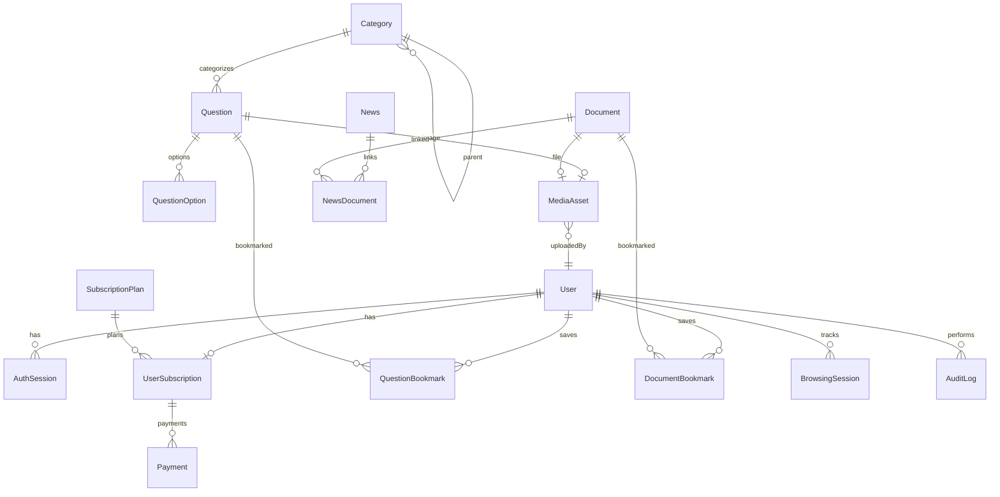

# 05 — Database Design

PostgreSQL via Prisma. Migrations are the source of truth. **Never** use `prisma db push` as the production migration strategy.

**Location:** `backend/prisma/schema.prisma` and `backend/prisma/migrations/`.  
**Commands (repo root):** `pnpm db:deploy`, `pnpm db:seed`, `pnpm db:generate`.

## 1. ER Overview

## 2. Soft-Delete Strategy

| Entity | Strategy |
|--------|----------|
| User | Soft: `deletedAt`; unique WhatsApp released or rewritten on delete per DEC-005 |
| Category | Soft prefer: `isActive=false`; hard delete only if no questions |
| Question | Status `ARCHIVED` + optional `deletedAt` |
| News | `isPublished` + optional `deletedAt` |
| Document | `deletedAt`; enqueue Cloudinary cleanup |
| Bookmarks | Hard delete |
| AuthSession | Hard delete / expire |
| AuditLog | Append-only; no delete |

## 3. Entities

### 3.1 User

**Purpose:** Account identity, trial window, role, profile.

| Field | Type | Notes |
|-------|------|-------|
| id | UUID PK | |
| name | VARCHAR(120) | |
| whatsappNumber | VARCHAR(32) UNIQUE | E.164 normalized |
| email | VARCHAR(255) NULL UNIQUE | Optional |
| passwordHash | TEXT | Argon2id |
| role | ENUM(`USER`,`ADMIN`) | Default `USER` |
| status | ENUM(`ACTIVE`,`SUSPENDED`,`DELETED`) | |
| avatarAssetId | UUID NULL FK → MediaAsset | |
| trialStartedAt | TIMESTAMPTZ | Set at registration |
| trialEndsAt | TIMESTAMPTZ | `trialStartedAt + 7 days` |
| preferredCategoryIds | UUID[] | Root category interests from onboarding (max 3 in service) |
| lastQuestionId | UUID NULL FK → Question | Continue-learning pointer (`ON DELETE SET NULL`) |
| lastQuestionFilterQs | VARCHAR(512) NULL | Optional filter query string for resume |
| onboardingCompletedAt | TIMESTAMPTZ NULL | Set when onboarding finishes |
| createdAt / updatedAt | TIMESTAMPTZ | |
| deletedAt | TIMESTAMPTZ NULL | Soft delete |

**Indexes:** unique(whatsappNumber); unique(email) where not null; (status); (trialEndsAt); (createdAt).

**Cascade:** Deleting user (hard) cascades sessions, bookmarks, browsing sessions; questions createdBy set null or restrict for admins — prefer `createdById` SET NULL on content.

### 3.2 AuthSession

**Purpose:** Refresh token sessions / rotation.

| Field | Type | Notes |
|-------|------|-------|
| id | UUID PK | |
| userId | UUID FK → User | ON DELETE CASCADE |
| refreshTokenHash | TEXT | |
| familyId | UUID | Rotation family |
| userAgent | TEXT NULL | |
| ipAddress | VARCHAR(64) NULL | |
| expiresAt | TIMESTAMPTZ | |
| revokedAt | TIMESTAMPTZ NULL | |
| replacedBySessionId | UUID NULL | |
| createdAt | TIMESTAMPTZ | |

**Indexes:** (userId); (expiresAt); unique(refreshTokenHash).

### 3.3 Category

**Purpose:** Two-level hierarchy.

| Field | Type | Notes |
|-------|------|-------|
| id | UUID PK | |
| name | VARCHAR(120) | |
| slug | VARCHAR(140) UNIQUE | |
| description | TEXT NULL | |
| parentId | UUID NULL FK → Category | NULL = root |
| isActive | BOOLEAN | Default true |
| sortOrder | INT | Default 0 |
| createdAt / updatedAt | TIMESTAMPTZ | |

**Constraints:** CHECK: parent cannot reference self; application enforces max depth 2; prevent cycles.  
**Indexes:** (parentId); (isActive); (sortOrder).

### 3.4 Question

| Field | Type | Notes |
|-------|------|-------|
| id | UUID PK | |
| title | VARCHAR(200) | |
| content | TEXT | |
| explanation | TEXT NULL | Premium field |
| categoryId | UUID FK → Category | Required main |
| subcategoryId | UUID NULL FK → Category | Must be child of categoryId |
| difficulty | ENUM(`EASY`,`MEDIUM`,`HARD`) | |
| status | ENUM(`DRAFT`,`PUBLISHED`,`ARCHIVED`) | |
| imageAssetId | UUID NULL FK → MediaAsset | |
| createdById | UUID NULL FK → User | |
| publishedAt | TIMESTAMPTZ NULL | |
| createdAt / updatedAt | TIMESTAMPTZ | |
| deletedAt | TIMESTAMPTZ NULL | |

**Indexes:** (status, publishedAt DESC, id DESC); (categoryId, status); (subcategoryId, status); (difficulty, status); GIN/trigram optional for search later; `title`/`content` search via `pg_trgm` or simple ILIKE initially.

**Integrity:** subcategory.parentId must equal categoryId (enforce in service + DB trigger optional).

### 3.5 QuestionOption

| Field | Type | Notes |
|-------|------|-------|
| id | UUID PK | |
| questionId | UUID FK → Question | ON DELETE CASCADE |
| label | VARCHAR(10) | e.g. A/B/C/D |
| content | TEXT | |
| isCorrect | BOOLEAN | |
| sortOrder | INT | |

**Constraints:** Partial unique index: **at most one** `isCorrect=true` per question (unique on questionId WHERE isCorrect). Publish-time service ensures exactly one.  
**Indexes:** (questionId, sortOrder).

### 3.6 News

| Field | Type | Notes |
|-------|------|-------|
| id | UUID PK | |
| title | VARCHAR(200) | |
| slug | VARCHAR(220) UNIQUE | |
| summary | TEXT NULL | |
| body | TEXT | |
| coverAssetId | UUID NULL FK → MediaAsset | |
| isPublished | BOOLEAN | |
| publishedAt | TIMESTAMPTZ NULL | |
| createdById | UUID NULL FK → User | |
| createdAt / updatedAt | TIMESTAMPTZ | |
| deletedAt | TIMESTAMPTZ NULL | |

**Indexes:** (isPublished, publishedAt DESC); (slug).

### 3.7 Document (PDF / educational file)

| Field | Type | Notes |
|-------|------|-------|
| id | UUID PK | |
| title | VARCHAR(200) | |
| description | TEXT NULL | |
| mediaAssetId | UUID FK → MediaAsset | Required |
| categoryId | UUID NULL FK → Category | Optional organization |
| visibility | ENUM(`PUBLIC`,`AUTHENTICATED`,`PREMIUM`) | Default `AUTHENTICATED` (DEC-001: post-trial access allowed for authenticated users) |
| isPublished | BOOLEAN | |
| createdById | UUID NULL FK → User | |
| createdAt / updatedAt | TIMESTAMPTZ | |
| deletedAt | TIMESTAMPTZ NULL | |

### 3.8 NewsDocument

Join table: News M:N Document (association of PDFs with news).

| Field | Type |
|-------|------|
| newsId | UUID FK |
| documentId | UUID FK |
| sortOrder | INT |

PK: (newsId, documentId).

### 3.9 MediaAsset

**Purpose:** Cloudinary metadata — never store file bytes.

| Field | Type | Notes |
|-------|------|-------|
| id | UUID PK | |
| publicId | VARCHAR(255) | |
| resourceType | ENUM(`IMAGE`,`RAW`,`VIDEO`,`AUTO`) | |
| deliveryType | ENUM(`UPLOAD`,`PRIVATE`,`AUTHENTICATED`) | |
| format | VARCHAR(32) NULL | |
| bytes | INT | |
| mimeType | VARCHAR(127) | |
| width / height | INT NULL | |
| originalFilename | VARCHAR(255) NULL | |
| uploadedById | UUID NULL FK → User | |
| createdAt | TIMESTAMPTZ | |
| deletedAt | TIMESTAMPTZ NULL | |

**Indexes:** unique(publicId, resourceType); (uploadedById).

### 3.10 QuestionBookmark

| Field | Type |
|-------|------|
| id | UUID PK |
| userId | UUID FK → User ON DELETE CASCADE |
| questionId | UUID FK → Question ON DELETE CASCADE |
| createdAt | TIMESTAMPTZ |

**Unique:** (userId, questionId). **Indexes:** (userId, createdAt DESC).

### 3.11 DocumentBookmark

| Field | Type |
|-------|------|
| id | UUID PK |
| userId | UUID FK → User ON DELETE CASCADE |
| documentId | UUID FK → Document ON DELETE CASCADE |
| createdAt | TIMESTAMPTZ |

**Unique:** (userId, documentId).

### 3.12 BrowsingSession

| Field | Type | Notes |
|-------|------|-------|
| id | UUID PK | |
| userId | UUID FK → User | |
| startedAt | TIMESTAMPTZ | |
| lastHeartbeatAt | TIMESTAMPTZ | |
| endedAt | TIMESTAMPTZ NULL | |
| accruedSeconds | INT | Server-computed |
| clientInstanceId | VARCHAR(64) NULL | Tab/instance |
| userAgent | TEXT NULL | |
| status | ENUM(`ACTIVE`,`ENDED`,`EXPIRED`) | |

**Indexes:** (userId, startedAt DESC); partial unique active session policy per DEC-010.

### 3.13 SubscriptionPlan

| Field | Type |
|-------|------|
| id | UUID PK |
| code | VARCHAR(64) UNIQUE |
| name | VARCHAR(120) |
| description | TEXT NULL |
| durationDays | INT |
| priceCents | INT | Future |
| currency | CHAR(3) | Future |
| entitlements | JSONB | e.g. `["VIEW_ANSWERS","VIEW_EXPLANATIONS"]` |
| isActive | BOOLEAN |
| createdAt / updatedAt | TIMESTAMPTZ |

### 3.14 UserSubscription

| Field | Type | Notes |
|-------|------|-------|
| id | UUID PK | |
| userId | UUID FK → User | |
| planId | UUID FK → SubscriptionPlan | |
| status | ENUM(`ACTIVE`,`CANCELED`,`EXPIRED`,`PAST_DUE`) | |
| startsAt | TIMESTAMPTZ | |
| endsAt | TIMESTAMPTZ | |
| canceledAt | TIMESTAMPTZ NULL | |
| createdAt / updatedAt | TIMESTAMPTZ | |

**Indexes:** (userId, status); (endsAt).  
**Integrity:** Prefer no overlapping ACTIVE periods per user (service-enforced; optional exclusion constraint later).

### 3.15 Payment

Future-ready placeholder.

| Field | Type |
|-------|------|
| id | UUID PK |
| userSubscriptionId | UUID FK |
| provider | VARCHAR(64) |
| providerRef | VARCHAR(255) |
| amountCents | INT |
| currency | CHAR(3) |
| status | ENUM(`PENDING`,`SUCCEEDED`,`FAILED`,`REFUNDED`) |
| rawPayload | JSONB NULL |
| createdAt | TIMESTAMPTZ |

**Unique:** (provider, providerRef).

### 3.16 AuditLog

| Field | Type |
|-------|------|
| id | UUID PK |
| actorUserId | UUID NULL FK |
| action | VARCHAR(80) |
| entityType | VARCHAR(80) |
| entityId | UUID NULL |
| metadata | JSONB |
| ipAddress | VARCHAR(64) NULL |
| createdAt | TIMESTAMPTZ |

**Indexes:** (createdAt DESC); (entityType, entityId); (actorUserId, createdAt DESC).

## 4. Transactions (Examples)

- Publish question: validate options + set status/publishedAt in one transaction.
- Register: create user + trial timestamps (+ optional avatar asset) atomically.
- Bookmark add: insert with unique conflict → 409.
- Document create: insert MediaAsset + Document; compensate Cloudinary on failure via queue.

## 5. Prisma Notes

- Map enums explicitly.
- Use `@db.Timestamptz` for all timestamps.
- UUID via `@default(uuid())` or `gen_random_uuid()`.
- Enable extensions as needed: `pgcrypto`, `pg_trgm` for search.

## 6. Migration Policy

1. Edit `schema.prisma`
2. `prisma migrate dev` locally
3. Commit SQL migrations
4. Production: `prisma migrate deploy`
5. Never rewrite applied migrations on shared branches
