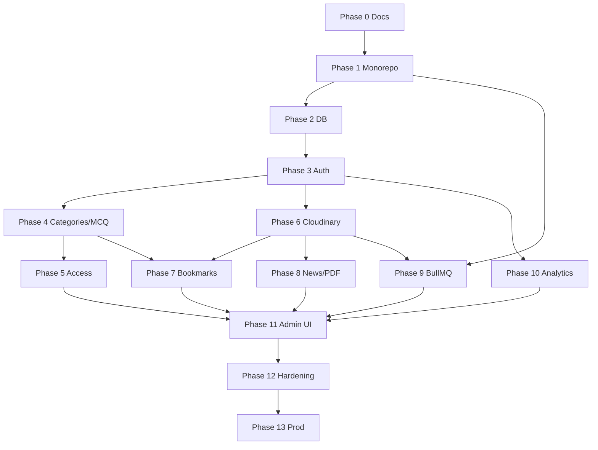

# 16 — Development Roadmap

Dependency-ordered phases. Complete acceptance criteria before advancing.

---

## Phase 0 — Requirements and Documentation

**Status:** Complete in this task.

**Deliverables:** `AGENTS.md`, `README.md`, `.cursor/rules/*`, `docs/00`–`19`.

**Acceptance:** Consistency audit passes; open decisions listed in `19-decisions-and-assumptions.md`.

---

## Phase 1 — Monorepo and Infrastructure Setup

**Depends on:** Phase 0  
**Status:** Complete — verified with `pnpm build`, `pnpm lint`, `pnpm typecheck`, and `pnpm docker:dev` (Postgres/Redis/API/Web/Worker/Nginx healthy).

**Work:**

- Initialize monorepo (pnpm workspaces + Turborepo)
- Scaffold `apps/web`, `apps/api`, `apps/worker`, `packages/shared`
- Base ESLint/Prettier/tsconfig
- Docker Compose: postgres, redis, api, worker, web, nginx
- CI lint/build skeleton (GitHub Actions)
- Env example files (`.env.example`)

**Acceptance:** `compose up` runs Postgres+Redis; empty API health endpoint responds; web hello page builds.

---

## Phase 2 — Database and Prisma Setup

**Depends on:** Phase 1

**Work:**

- Prisma schema for all entities in `05-database-design.md`
- Initial migration
- Seed script (admin user, sample categories)
- PrismaService module

**Acceptance:** `migrate deploy` on clean DB succeeds; seed creates admin; schema matches docs.

---

## Phase 3 — Authentication and User Management

**Depends on:** Phase 2

**Work:**

- Register/login/logout/refresh/change-password
- HTTP-only access/refresh cookies + CSRF guard (DEC-012); CORS credentials
- Password reset via email (DEC-004) + `email-queue` stub/provider
- Argon2id; sessions; JWT guards; RBAC
- Profile get/update
- Rate limiting on auth routes
- Swagger for auth/users (Bearer for non-browser)

**Acceptance:** Auth API tests green; refresh rotation works; CSRF rejects mutating requests without header; suspended users blocked; trial timestamps set; forgot-password sends mail when email present and never enumerates accounts.

---

## Phase 4 — Categories and MCQ Management

**Depends on:** Phase 3

**Work:**

- Category hierarchy admin + list
- Question CRUD admin; options; publish validation
- Learner list/detail/navigation (answers still always returned temporarily **or** stub access service — prefer early Phase 5 hook)

**Acceptance:** Publish rejects invalid options; deterministic prev/next; filters/search/pagination work.

---

## Phase 5 — Trial and Access Control

**Depends on:** Phase 4

**Work:**

- `AccessControlService` + `/me/access`
- Strip answers/explanations for expired trial
- SubscriptionPlan/UserSubscription read paths
- Automated privacy tests

**Acceptance:** Privacy tests prove field omission; trial users see answers; no payment required.

---

## Phase 6 — Cloudinary and Document Management

**Depends on:** Phase 3 (can parallelize after 3 with Phase 4)

**Work:**

- StorageService + Cloudinary implementation
- Sign-upload/confirm; avatar; question images
- MediaAsset persistence; orphan cleanup job stub

**Acceptance:** Upload without exposing secrets; metadata stored; delete path works with mocks/tests.

---

## Phase 7 — Bookmarks and User Dashboard

**Depends on:** Phases 4–6

**Work:**

- Question/document bookmarks
- User stats dashboard endpoints + UI

**Acceptance:** Duplicate bookmarks 409; ownership enforced; paginated lists.

---

## Phase 8 — News and PDF Management

**Depends on:** Phase 6

**Work:**

- News CRUD/publish; document association
- Learner news browse; PDF signed download per policy
- PDF gating per DEC-001 (post-trial authenticated access confirmed)

**Acceptance:** Published news visible; unpublished hidden; PDF delivery signed when private.

---

## Phase 9 — Redis and BullMQ Background Processing

**Depends on:** Phase 1; useful after 6–8

**Work:**

- Worker app; queues; email stub; document-processing; maintenance deletes
- Repeatable maintenance jobs
- Failure/retry configuration

**Acceptance:** Job retries idempotent; API remains responsive without inline PDF heavy work.

---

## Phase 10 — Browsing Analytics

**Depends on:** Phase 3

**Work:**

- Session start/heartbeat/end
- Visibility/idle/multi-tab policy per decisions
- User + admin summaries
- Anti-inflation clamps

**Acceptance:** Hidden tab does not inflate; concurrent tab policy matches DEC-010; admin aggregates coherent.

---

## Phase 11 — Admin Dashboard

**Depends on:** Phases 4–10

**Work:**

- KPI endpoint `/admin/dashboard`
- Admin UI pages wired to existing admin APIs
- Recent activity from AuditLog

**Acceptance:** All KPIs match DB counts; non-admin 403; RBAC on every mutation.

---

## Phase 12 — Testing and Security Hardening

**Depends on:** Features above

**Work:**

- Fill coverage gaps; e2e smoke
- Security checklist; header hardening; backup script documented
- Performance pass against NFR targets

**Acceptance:** Critical tests in CI; known high issues resolved; backup/restore drill noted.

---

## Phase 13 — Production Deployment

**Depends on:** Phase 12

**Work:**

- Prod compose; Nginx TLS; secrets on VPS
- GitHub Actions deploy
- Monitoring/log rotation
- Runbook

**Acceptance:** Public HTTPS; migrations on deploy; health green; DB/Redis not public.

---

## Dependency Graph

## Recommended Next Step

Start **Phase 1**. DEC-001, DEC-003, DEC-004, and DEC-012 (cookies + CSRF) are confirmed.
